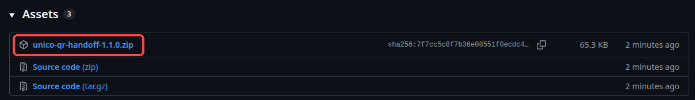
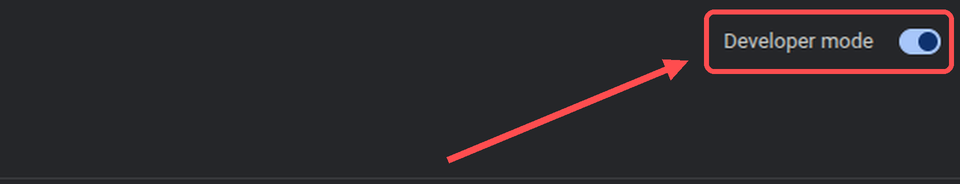
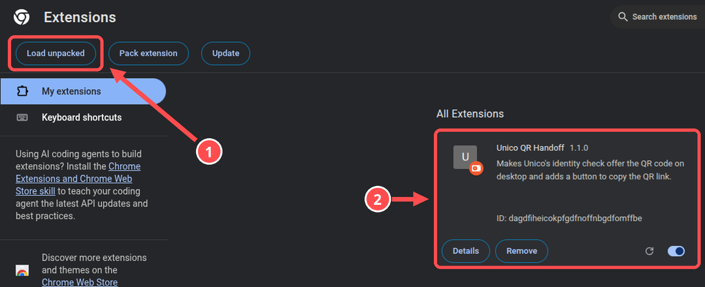
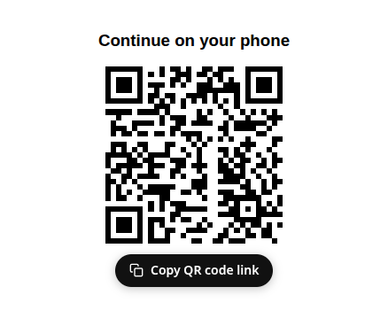
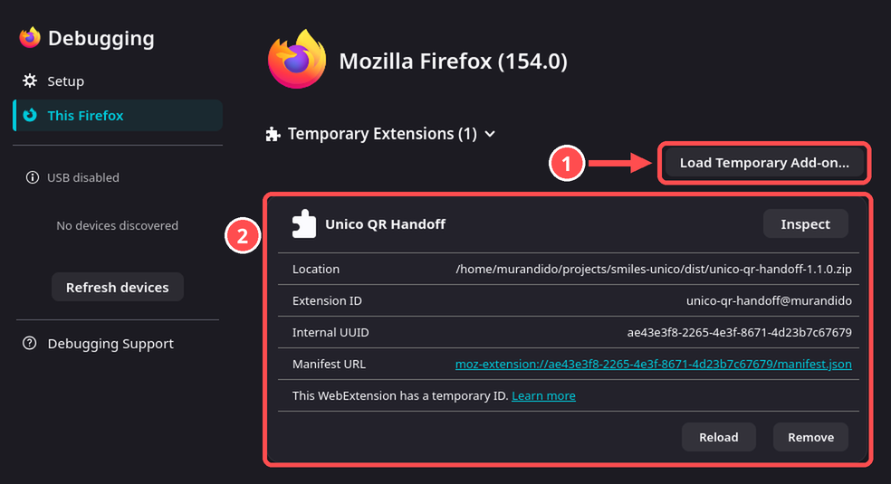

# Step-by-step guide

It takes about 2 minutes, and you only do it once.

> 🇧🇷 [Versão em português](INSTALL.pt-BR.md)

## Chrome

### 1. Download

Open the [latest release](https://github.com/murandido/unico-qr-handoff/releases/latest) and click **`unico-qr-handoff-<version>.zip`**.

Then **unzip** it: right-click the file and choose *Extract here*. You now have a folder.

### 2. Turn on Developer mode

Type `chrome://extensions` in the address bar and press Enter. Turn on **Developer mode** in the top-right corner.

### 3. Load the extension

① Click **Load unpacked** and pick the folder you unzipped in step 1.

② **Unico QR Handoff** shows up in the list. You're done!

Leave the folder where it is, because Chrome loads the extension from it.

### 4. Use it

Go on with your ticket issuance as usual. When the face check starts, you'll see a **QR code** instead of your webcam:

- **scan it** with your phone, or
- click **Copy QR code link** and send the link to your phone (WhatsApp, Telegram, e-mail…).

Take the selfie on your phone, and the computer moves on by itself.

> Open the link **on your phone**. On this computer it would just show the QR code again.

## Firefox (140 or newer)

1. Download the `.zip` as in step 1. You don't need to unzip it.
2. Type `about:debugging#/runtime/this-firefox` in the address bar and press Enter.
3. ① Click **Load Temporary Add-on…** and pick the `.zip`. ② **Unico QR Handoff** shows up under *Temporary Extensions*.

Firefox removes temporary add-ons when it closes, so you need to repeat step 3 after each restart.

## Updating

Download the new `.zip`, unzip it over the old folder, and click the **↻** button on the extension card in `chrome://extensions`.

## Trouble?

- **Still seeing the webcam?** Close the face check window and start it again. The page has to reload with the extension on.
- **No Copy button?** Wait a second after the QR shows up. If it still doesn't appear, scanning the QR always works.
- Still stuck? [Open an issue](https://github.com/murandido/unico-qr-handoff/issues).
