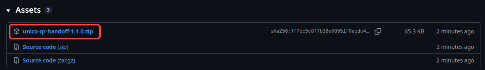
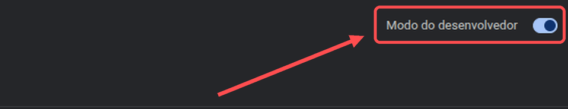
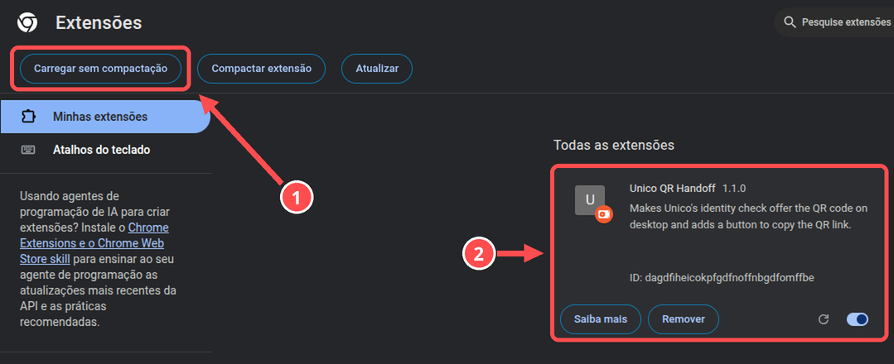
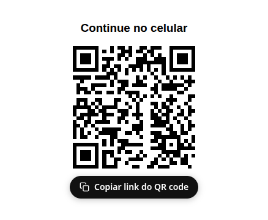
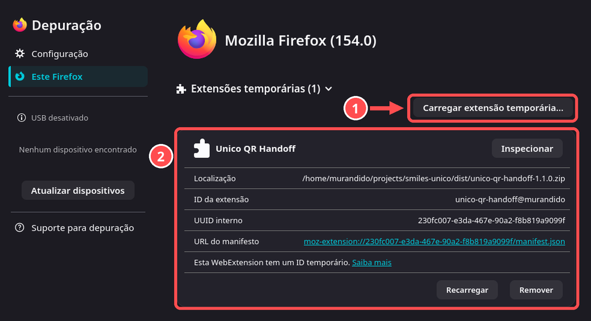

# Passo a passo

Leva uns 2 minutos, e você só faz uma vez.

> 🇺🇸 [English version](INSTALL.md)

## Chrome

### 1. Baixe

Abra a [última release](https://github.com/murandido/unico-qr-handoff/releases/latest) e clique em **`unico-qr-handoff-<versão>.zip`**.

Depois **descompacte**: clique com o botão direito no arquivo e escolha *Extrair aqui*. Vai aparecer uma pasta.

### 2. Ligue o Modo do desenvolvedor

Digite `chrome://extensions` na barra de endereço e aperte Enter. Ligue o **Modo do desenvolvedor**, no canto superior direito.

### 3. Carregue a extensão

① Clique em **Carregar sem compactação** e escolha a pasta que você descompactou no passo 1.

② O **Unico QR Handoff** aparece na lista. Pronto!

Não apague nem mova a pasta, porque o Chrome carrega a extensão a partir dela.

### 4. Use

Faça a emissão normalmente. Quando chegar a verificação facial, em vez da câmera do computador vai aparecer um **QR code**:

- **escaneie** com o celular, ou
- clique em **Copiar link do QR code** e mande o link para o celular (WhatsApp, Telegram, e-mail…).

Tire a selfie no celular, e o computador continua sozinho.

> Abra o link **no celular**. Neste computador ele só mostraria o QR de novo.

## Firefox (140 ou mais novo)

1. Baixe o `.zip` como no passo 1. Não precisa descompactar.
2. Digite `about:debugging#/runtime/this-firefox` na barra de endereço e aperte Enter.
3. ① Clique em **Carregar extensão temporária…** e escolha o `.zip`. ② O **Unico QR Handoff** aparece em *Extensões temporárias*.

O Firefox remove extensões temporárias quando fecha, então você precisa repetir o passo 3 sempre que reabrir o navegador.

## Atualizar

Baixe o `.zip` novo, descompacte por cima da pasta antiga e clique no botão **↻** do card da extensão em `chrome://extensions`.

## Problemas?

- **Ainda aparece a câmera?** Feche a janela da verificação e comece de novo. A página precisa recarregar com a extensão ligada.
- **O botão de copiar não aparece?** Espere um segundo depois que o QR aparecer. Se mesmo assim não vier, escanear o QR sempre funciona.
- Nada resolveu? [Abra uma issue](https://github.com/murandido/unico-qr-handoff/issues).
